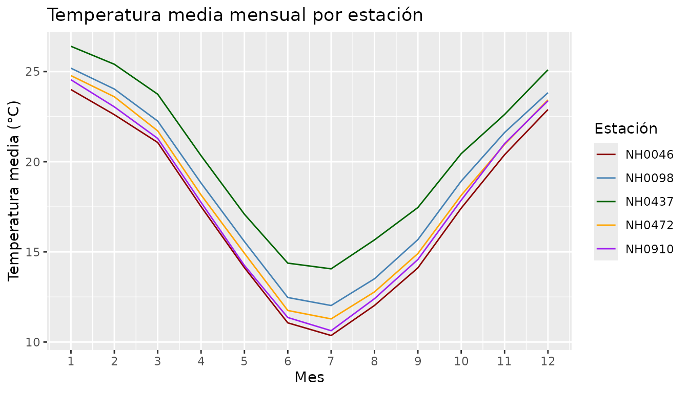
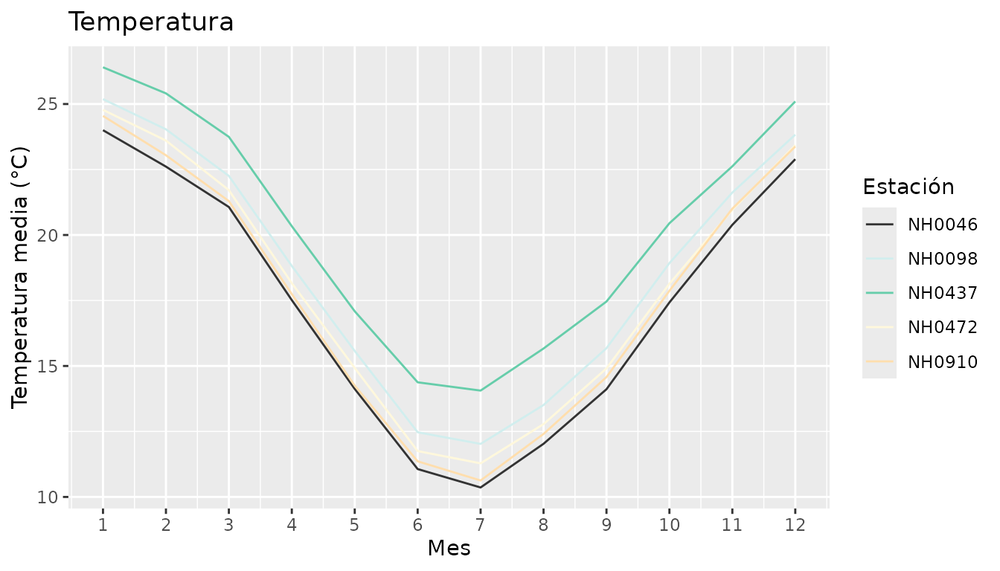

# meteorologicor

``` r

library(MeteorologicoR)
```

MeteorologicoR reúne las funciones que desarrollamos durante los
trabajos transversales de Programación II para trabajar con datos de
estaciones meteorológicas del INTA. En esta viñeta mostramos cómo se usa
cada una.

## Los datos

El paquete incluye `estaciones`, un data.frame con las mediciones
diarias de cinco estaciones de Santa Fe entre 1961 y 2023:

``` r

head(estaciones)
#>       id      fecha temperatura_abrigo_150cm temperatura_abrigo_150cm_minima
#> 1 NH0472 1961-07-01                     11.1                             8.8
#> 2 NH0472 1961-07-02                      5.5                             0.5
#> 3 NH0472 1961-07-03                      6.0                             1.2
#> 4 NH0472 1961-07-04                       NA                             7.0
#> 5 NH0472 1961-07-05                     12.4                            10.0
#> 6 NH0472 1961-07-06                     11.0                             5.5
#>   temperatura_abrigo_150cm_maxima precipitacion_pluviometrica
#> 1                            13.4                           0
#> 2                            10.5                           0
#> 3                            10.8                           0
#> 4                              NA                           0
#> 5                            14.8                           0
#> 6                            16.5                           0
#>   humedad_media_8_14_20
#> 1                    81
#> 2                    80
#> 3                    62
#> 4                    93
#> 5                    92
#> 6                    80
```

Son 95681 filas y siete columnas: el código de la estación, la fecha,
tres columnas de temperatura, la precipitación y la humedad.

``` r

unique(estaciones$id)
#> [1] "NH0472" "NH0910" "NH0046" "NH0098" "NH0437"
```

## Resumir las temperaturas

[`tabla_resumen_temperatura()`](https://boglicdelfina.github.io/MeteorologicoR/reference/tabla_resumen_temperatura.md)
toma un data.frame con mediciones y devuelve el promedio y el desvío
estándar de la temperatura de abrigo a 150 cm para cada estación:

``` r

tabla_resumen_temperatura(estaciones)
#> # A tibble: 5 × 3
#>   id     promedio desvio
#>   <chr>     <dbl>  <dbl>
#> 1 NH0046     17.3   5.90
#> 2 NH0098     18.6   5.98
#> 3 NH0437     20.2   5.77
#> 4 NH0472     18.0   5.94
#> 5 NH0910     17.7   6.12
```

NH0437 es la más cálida en promedio y NH0046 la más fresca. El desvío es
parecido en todas, entre 5.8 y 6.1 °C.

La función funciona igual con una sola estación:

``` r

tabla_resumen_temperatura(subset(estaciones, id == "NH0437"))
#> # A tibble: 1 × 3
#>   id     promedio desvio
#>   <chr>     <dbl>  <dbl>
#> 1 NH0437     20.2   5.77
```

## Graficar el ciclo anual

[`grafico_temperatura_mensual()`](https://boglicdelfina.github.io/MeteorologicoR/reference/grafico_temperatura_mensual.md)
calcula el promedio mensual y lo grafica con una línea por estación:

``` r

grafico_temperatura_mensual(
  estaciones,
  colores = c("darkred", "steelblue", "darkgreen", "orange", "purple"),
  titulo = "Temperatura media mensual por estación"
)
```



El ciclo tiene la misma forma en las cinco: máximo en enero, mínimo en
julio, con una amplitud de unos 17 °C. Las curvas corren casi paralelas,
así que las estaciones se diferencian por el nivel general de
temperatura y no por la forma del ciclo.

Los dos argumentos opcionales tienen valores por defecto. Si no
indicamos colores, la función elige cinco al azar y avisa; si no
indicamos título, usa “Temperatura”:

``` r

grafico_temperatura_mensual(estaciones)
#> No se indicaron colores, se eligieron 5 al azar.
```



## Leer los datos de otra estación

Las funciones anteriores trabajan con los datos que ya vienen en el
paquete, pero el INTA tiene muchas estaciones más.
[`leer_estacion()`](https://boglicdelfina.github.io/MeteorologicoR/reference/leer_estacion.md)
descarga y lee cualquiera de ellas a partir de su código:

``` r

otra <- leer_estacion("NH0098", "datos/NH0098.csv")
```

Si el archivo ya está en esa ruta, la función lo lee directamente en vez
de volver a descargarlo, y avisa cuál de los dos caminos tomó.

## Cuando algo sale mal

Las tres funciones revisan sus argumentos antes de hacer nada y cortan
con un mensaje claro:

``` r

tabla_resumen_temperatura("hola")
#> Error in `tabla_resumen_temperatura()`:
#> ! El argumento datos debe ser un data.frame.
#> ℹ La variable ingresada es un character.
```

``` r

tabla_resumen_temperatura(data.frame(id = "NH0437"))
#> Error in `tabla_resumen_temperatura()`:
#> ! La tabla no tiene la columna temperatura_abrigo_150cm.
```

``` r

grafico_temperatura_mensual(estaciones, colores = c("red", "blue"))
#> Error in `grafico_temperatura_mensual()`:
#> ! Faltan colores para graficar todas las estaciones.
#> ℹ Hay 5 estaciones y se indicaron 2 colores.
```
