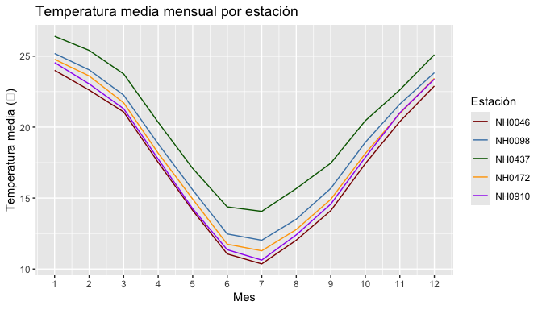

# MeteorologicoR

MeteorologicoR reúne las funciones que desarrollamos durante los
trabajos transversales de Programación II para trabajar con datos de
estaciones meteorológicas del INTA. Sirve para descargar los datos de
una estación, resumir sus temperaturas y graficar el ciclo anual sin
tener que reescribir el mismo código cada vez.

Está pensado para estudiantes y docentes que trabajen con los datos del
Sistema de Información y Gestión Agropecuaria (SIGA).

## Instalación

Podés instalar la versión en desarrollo desde
[GitHub](https://github.com/boglicdelfina/MeteorologicoR) con:

``` r

# install.packages("pak")
pak::pak("boglicdelfina/MeteorologicoR")
```

## Cómo empezar

El paquete incluye `estaciones`, con las mediciones diarias de cinco
estaciones de Santa Fe:

``` r

library(MeteorologicoR)

head(estaciones)
#>       id      fecha temperatura_abrigo_150cm temperatura_abrigo_150cm_minima
#> 1 NH0472 1961-07-01                     11.1                             8.8
#> 2 NH0472 1961-07-02                      5.5                             0.5
#> 3 NH0472 1961-07-03                      6.0                             1.2
#> 4 NH0472 1961-07-04                       NA                             7.0
#> 5 NH0472 1961-07-05                     12.4                            10.0
#> 6 NH0472 1961-07-06                     11.0                             5.5
#>   temperatura_abrigo_150cm_maxima precipitacion_pluviometrica
#> 1                            13.4                           0
#> 2                            10.5                           0
#> 3                            10.8                           0
#> 4                              NA                           0
#> 5                            14.8                           0
#> 6                            16.5                           0
#>   humedad_media_8_14_20
#> 1                    81
#> 2                    80
#> 3                    62
#> 4                    93
#> 5                    92
#> 6                    80
```

[`tabla_resumen_temperatura()`](https://boglicdelfina.github.io/MeteorologicoR/reference/tabla_resumen_temperatura.md)
devuelve el promedio y el desvío estándar de la temperatura de abrigo
para cada estación:

``` r

tabla_resumen_temperatura(estaciones)
#> # A tibble: 5 × 3
#>   id     promedio desvio
#>   <chr>     <dbl>  <dbl>
#> 1 NH0046     17.3   5.90
#> 2 NH0098     18.6   5.98
#> 3 NH0437     20.2   5.77
#> 4 NH0472     18.0   5.94
#> 5 NH0910     17.7   6.12
```

[`grafico_temperatura_mensual()`](https://boglicdelfina.github.io/MeteorologicoR/reference/grafico_temperatura_mensual.md)
muestra el ciclo anual, con una línea por estación:

``` r

grafico_temperatura_mensual(
  estaciones,
  colores = c("darkred", "steelblue", "darkgreen", "orange", "purple"),
  titulo = "Temperatura media mensual por estación"
)
```



Si no le pasás colores los elige al azar, y el título por defecto es
“Temperatura”.

Y
[`leer_estacion()`](https://boglicdelfina.github.io/MeteorologicoR/reference/leer_estacion.md)
descarga y lee los datos de cualquier estación del INTA a partir de su
código.

## Autores

- Delfina Boglic
- Kevin Milberg

## Contribuir

Nos interesan sobre todo los reportes de errores y las sugerencias de
funciones nuevas para analizar otras variables del dataset, como la
precipitación o la humedad. Si querés contribuir, abrí un
[issue](https://github.com/boglicdelfina/MeteorologicoR/issues).
